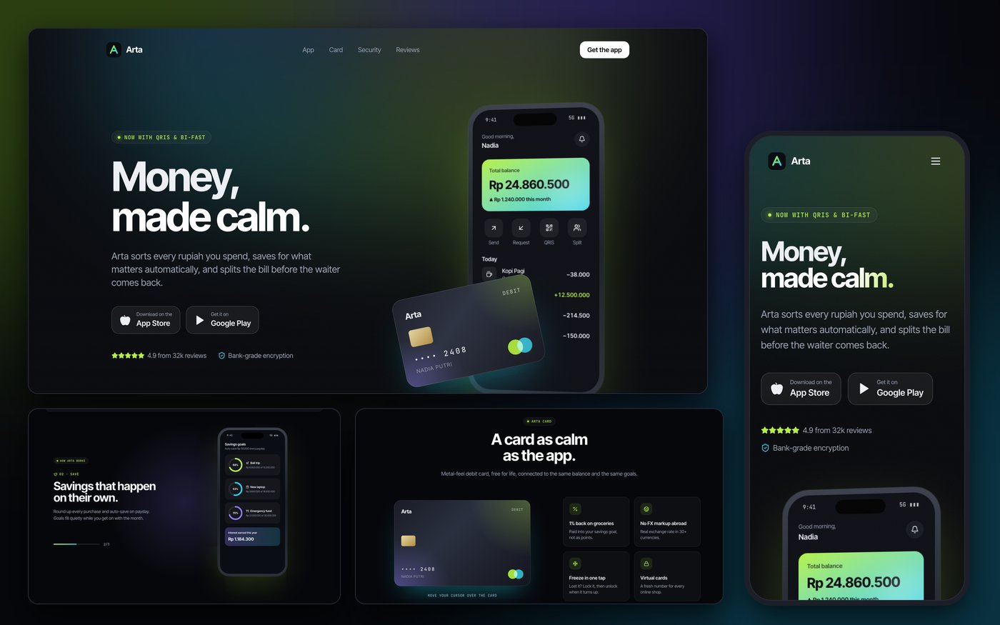

# Arta · fintech app landing page

[](https://github.com/dinulimann/arta-fintech-landing/actions/workflows/ci.yml)



A dark, cinematic marketing site for **Arta**, a fictional personal-finance app for Indonesia: spending insights, savings goals, split bills over QRIS and a debit card. It is a design and front-end portfolio piece. Arta is not a bank or a licensed financial service, and the names, reviews and figures are made up.

Built with **React 19**, **TypeScript**, **Vite**, **Tailwind CSS 4** and **Motion**, with **lucide** icons and the **Inter Tight** and **JetBrains Mono** typefaces.

## What to look at

- **Scroll-linked storytelling.** In "How Arta works" the phone stays pinned while you scroll through three chapters; its screen switches from spending insights to savings goals to a split bill, and a progress bar tracks the chapter.
- **A phone and a card built in HTML, not images.** Four app screens (balance, insights, goals with progress rings, split bill) are real markup. The hero phone leans back and rises as you scroll, while the card drifts the other way.
- **A debit card that follows the cursor,** with spring-smoothed 3D tilt and a moving sheen.
- **Atmosphere:** a slowly drifting aurora, film-grain noise, a gradient shine on the headline, cards with a spotlight that follows the cursor, a QR code with a scanning line, pulsing security rings and two review rows scrolling in opposite directions.
- **Reduced motion is respected everywhere.** With the OS setting on, scroll effects and loops stop and numbers render at their final values.
- **Responsive:** from a 390 px phone up, with a mobile menu and no sideways scroll.

## Tests

5 Playwright tests run in CI against the production build:

- every section renders and the nav links resolve
- the pinned phone changes screen chapter by chapter as you scroll
- the card's 3D transform changes when the cursor moves over it
- on a phone the menu works and nothing scrolls sideways
- with reduced motion, loops are still and numbers are final

## Run it

```bash
npm install
npm run dev          # http://localhost:5173
npm run build        # type-check and build to dist/
npx playwright install chromium && npm run test:e2e
```

`dist/` is a static site and can be hosted anywhere.
